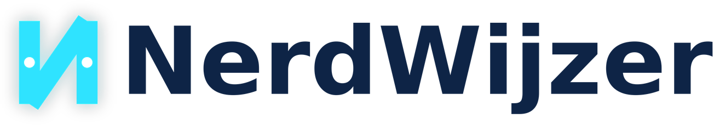

# NerdWijzer

**De nerdy stemhulp over IT, privacy en technologie.**

[nerdwijzer.nl](https://nerdwijzer.nl)



NerdWijzer helpt je in een paar minuten de politieke partij te vinden die het beste past bij jouw standpunten over digitale onderwerpen. Van chatcontrol tot open source, van AI-regulering tot digitale soevereiniteit.

> *Let op: dit is een onafhankelijke, nerdy stemhulp. Handig, geen bindend advies.*

## Wat maakt NerdWijzer anders?

Waar traditionele stemwijzers breed gaan, gaat NerdWijzer diep. Alle 30+ stellingen gaan over onderwerpen die er voor nerds toe doen:

- Ministerie van Digitale Zaken
- Open source bij de overheid
- EU-datahosting en digitale soevereiniteit
- Big Tech regulering en opsplitsing
- Chatcontrol en scannen van privéberichten
- Bulkinterceptie (Sleepwet)
- Hackbevoegdheden van de politie
- Bescherming van ethische hackers
- Gezichtsherkenning en biometrie
- Netneutraliteit
- AI-regulering en transparantie
- Recht op reparatie en encryptie
- En meer...

## Partijen

Standpunten van 18 Nederlandse politieke partijen, elk onderbouwd met bronvermeldingen uit verkiezingsprogramma's, Kamerdebatten en publieke uitspraken:

BBB, BIJ1, CDA, ChristenUnie, D66, DENK, FvD, GroenLinks-PvdA, JA21, NSC, Piratenpartij, PvdD, PVV, SGP, SP, Volt, VVD, 50PLUS

## Features

- **30+ stellingen** met uitgebreide toelichting
- **18 partijen** met onderbouwde standpunten en bronvermelding
- **Slider-interface** (1-5 schaal) voor genuanceerde antwoorden
- **Onderwerpweging** — geef meer gewicht aan thema's die je belangrijk vindt
- **Verantwoording** — elke partijpositie is onderbouwd met bronnen
- **Digitale Agenda** — overzicht van digitale beleidsplannen per partij
- **Progressive Web App** — installeerbaar op je telefoon, werkt offline
- **Responsive design** — optimaal op desktop, tablet en mobiel
- **Privacy-first** — geen tracking, geen cookies, alle data blijft lokaal

## Zelf draaien

NerdWijzer is een volledig statische site. Geen backend, geen database, geen build tools.

### Optie 1: gewoon openen

Open `index.html` in je browser. Klaar.

### Optie 2: lokale server

```bash
# Python
python3 -m http.server 8000

# PHP
php -S localhost:8000

# Node.js (npx)
npx serve .
```

### Optie 3: Docker

```bash
docker run -d -p 8080:80 -v $(pwd):/usr/share/nginx/html:ro nginx:alpine
```

Open daarna [localhost:8080](http://localhost:8080).

## Bestandsstructuur

```
nerdwijzer/
├── index.html              # Hoofdpagina (stemwijzer interface)
├── style.css               # Volledige styling (dark theme, responsive)
├── questions.json          # 30+ stellingen met toelichtingen
├── party_positions.json    # Partijstandpunten met bronvermeldingen
├── verantwoording.html     # Bronverantwoording per stelling
├── digitale-agenda.html    # Digitale beleidsagenda per partij
├── digitale-agenda-data.json
├── privacy.html            # Privacyverklaring
├── changelog.html          # Versiegeschiedenis
├── dankwoord.html          # Credits
├── manifest.json           # PWA manifest
├── sw.js                   # Service worker (offline support)
├── sitemap.xml
├── robots.txt
├── version.json
├── images/                 # Logo's en favicons
└── logos/                  # Partijlogo's (18 partijen)
```

## Bijdragen

Feedback, correcties en suggesties zijn welkom! Het liefst via:

- Een [GitHub issue](https://github.com/randomdreft/nerdwijzer/issues) aanmaken
- Het [#nerdwijzer-feedback](https://metnerdsomtafel.nl/slack) kanaal op de Slack van Met Nerds om Tafel

Vooral welkom:
- Feitelijke correcties op partijstandpunten (graag met bron)
- Suggesties voor nieuwe stellingen
- Bugs en UX-verbeteringen

## Verantwoording

Alle partijposities zijn gebaseerd op verkiezingsprogramma's, Kamerdebatten, moties en publieke uitspraken. Zie [verantwoording](https://nerdwijzer.nl/verantwoording.html) voor de volledige bronnenlijst.

## Licentie

Dit project is open source en vrij te gebruiken en aan te passen.

## Credits

Gebouwd door [Met Nerds om Tafel](https://metnerdsomtafel.nl) — een podcast en community voor nerds die meer willen weten over technologie, privacy en digitale rechten.
